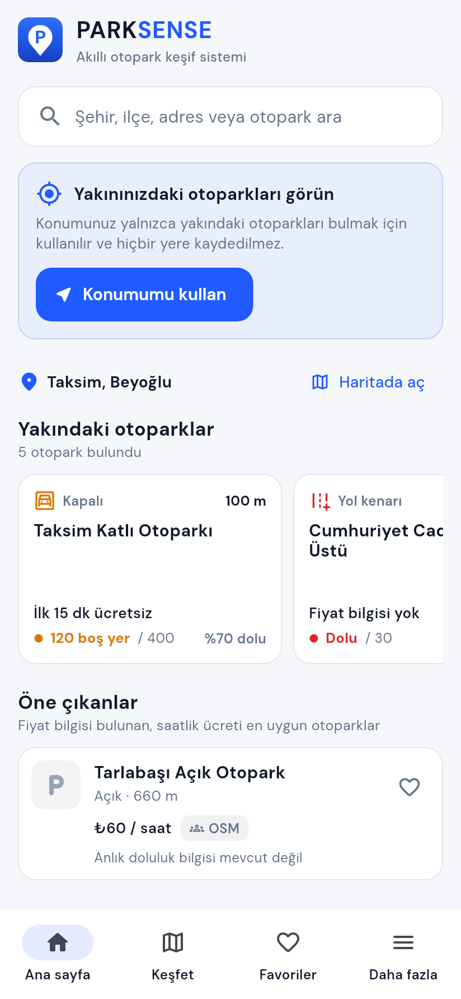
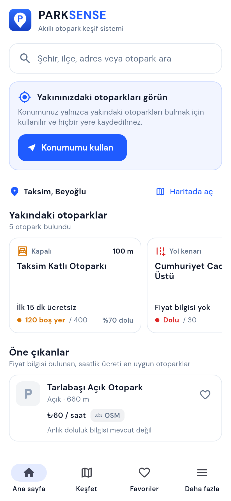
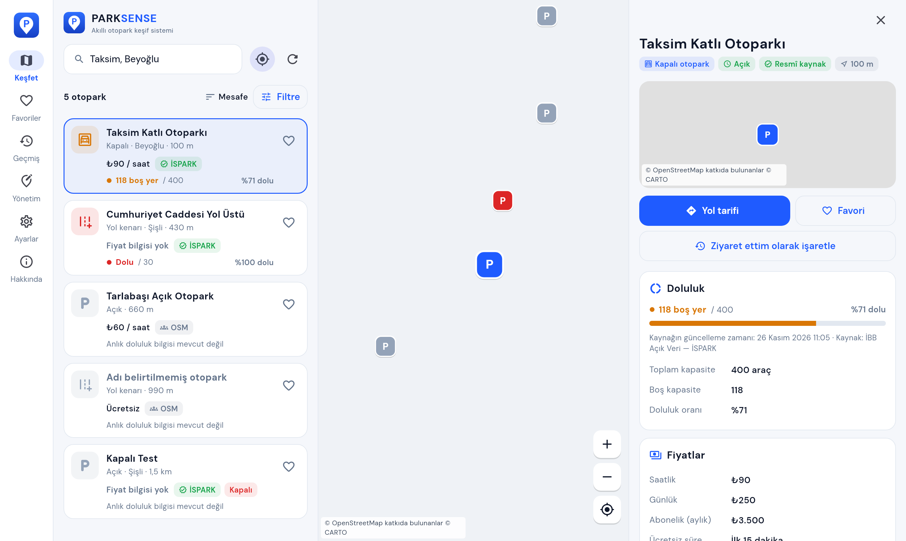

<p align="center">
  
</p>

<h1 align="center">PARKSENSE</h1>
<p align="center"><b>Akıllı otopark keşif sistemi</b> — Türkiye'deki otoparkları harita üzerinde keşfedin,<br>fiyat ve doluluk bilgilerini inceleyin, tek dokunuşla yol tarifi alın.</p>

<p align="center">
  <a href="https://github.com/furkantr1923/parksense/actions/workflows/build.yml"></a>
  
  
  
  
</p>

<p align="center">
  <a href="https://github.com/furkantr1923/parksense/releases/latest"><b>⬇️ İndir (Windows Setup · Portable · Android APK)</b></a>
</p>

---

## ✨ Öne çıkanlar

| | |
|---|---|
| 🗺️ **Harita** | OpenStreetMap tabanlı, API anahtarı gerektirmez. Kümelenmiş işaretler, konum, yakınlaştırma, "Bu bölgede ara". |
| 📊 **Gerçek doluluk** | İstanbul'da İSPARK'ın resmî açık verisiyle anlık boş yer. Diğer yerlerde açıkça *"Anlık doluluk bilgisi mevcut değil"*. |
| 💰 **Fiyatlar** | Saatlik, günlük, abonelik ve tarife kademeleri (₺). Kaynağı olmayan fiyat **asla tahmin edilmez**. |
| 🎛️ **Filtreler** | Tür · mesafe · fiyat · doluluk — birlikte çalışır, sonuç yoksa açık mesaj. |
| 🧭 **Navigasyon** | Google Maps uygulaması; yoksa tarayıcıda yol tarifi. |
| ❤️ **Kişisel** | Favoriler, son görüntülenenler, ziyaret geçmişi, yıldız puanı — yalnızca cihazda (SQLite). |
| 🛠️ **Yönetim** | Yerel otopark ekle / düzenle / sil, fiyat ve kapasite güncelle. |
| 📴 **Çevrimdışı** | Bağlantı yoksa önbellekteki otoparklar (doluluk gösterilmeden). |
| 🔒 **Gizlilik** | Hesap yok, bulut yok, reklam yok, analitik yok. Konum kaydedilmez. |

## 📸 Ekranlar

> Arayüz önizlemeleri `tool/screenshots` testleriyle üretilmiştir (test verisi; harita altlığı testte ağ olmadığı için kapalıdır).

| Android — Ana sayfa | Android — Liste | Android — Detay (İSPARK) |
|---|---|---|
|  |  |  |

| Windows — Liste · Harita · Detay |
|---|
|  |

## 🧱 Mimari

```
lib/
├── app/            Tema, uygulama kimliği, platform algılama
├── core/           Mesafe (Haversine), ₺ biçimlendirme, HTTP katmanı, hata türleri
├── domain/         Otopark modeli, filtreler, tarife ayrıştırıcı, kümeleme, doğrulama  ← saf Dart, testli
├── data/
│   ├── providers/  İSPARK · OpenStreetMap (Overpass) · Nominatim   ← bağımsız modüller
│   ├── db/         SQLite (8 tablo, yabancı anahtarlar, işlemler, sürümlü şema)
│   └── parking_repository.dart   birleştirme · tekrar ayıklama · önbellek · çevrimdışı yedek
├── services/       Konum, navigasyon, güncelleme denetimi
├── state/          AppController (ChangeNotifier)
├── ui/             Uyarlanabilir kabuk (Android alt çubuk / Windows yan ray), ekranlar, bileşenler
└── capture/        CI öz-sınama: gerçek veriyle ekran görüntüsü + rapor
```

**Veri akışı:** `Ekran → AppController → ParkingRepository → [İSPARK | OSM | Yerel] → SQLite önbellek`

- Her sağlayıcı `ParkingProvider` arayüzünü uygular; yeni bir belediye API'si tek dosyayla eklenir.
- Her kayıt **kaynak, güvenilirlik düzeyi ve güncelleme zamanı** taşır ve arayüzde gösterilir.
- Veritabanı `INSERT … ON CONFLICT DO UPDATE` kullanır; kaynak verisi tazelenince favoriler/geçmiş silinmez.

### Veritabanı

`Parking` · `ParkingPrice` · `ParkingRating` · `Favorite` · `RecentParking` · `VisitHistory` · `DataSource` · `AppSettings`

### Teknoloji seçimleri

| Konu | Seçim | Neden |
|---|---|---|
| Arayüz | Flutter 3.50 | Android + Windows tek kod tabanı |
| Harita | flutter_map + CARTO/OSM raster | Anahtarsız, GPU gerektirmez, Windows'ta olgun |
| Veritabanı | sqlite3 (FFI, derleme kancalı) | Android ve Windows'ta aynı motor, ek DLL yok |
| Durum | ChangeNotifier + InheritedNotifier | Bağımlılıksız, hafif |
| Kurulum | Inno Setup 6 + 7-Zip SFX | Sihirbazlı Setup + tek dosya Portable |

Ayrıntılar: [docs/DATA_SOURCES.md](docs/DATA_SOURCES.md)

## 🧪 Kalite

- **69 otomatik test** — fiyat/tarife, filtreleme, mesafe, veritabanı, favoriler, doğrulama, sağlayıcı ayrıştırma, entegrasyon ve arayüz
- **Gerçek çalıştırma** — her derlemede Windows uygulaması ve Android emülatörü gerçek veri kaynaklarıyla gezilir
- **Kurulum testi** — Setup sessiz kurulur, kısayollar doğrulanır, uygulama açılır, kaldırılır

Sonuçlar: [docs/TEST_REPORT.md](docs/TEST_REPORT.md)

## 🚀 Kurulum ve derleme

[docs/INSTALLATION.md](docs/INSTALLATION.md)

```bash
flutter pub get && flutter test && flutter run -d windows
```

## 📚 Veri kaynakları ve atıf

- Otopark verisi: **İBB Açık Veri — İSPARK** (İstanbul), **© OpenStreetMap katkıda bulunanlar** (ODbL)
- Harita: © OpenStreetMap katkıda bulunanlar © CARTO
- Adres araması: Nominatim · Yol tarifi: Google Maps

PARKSENSE 1.0 tüm Türkiye'yi eksiksiz kapsadığını iddia etmez; kapsam ayrıntıları veri kaynakları belgesindedir.

## 👤 Geliştirici

**Furkan** — [github.com/furkantr1923](https://github.com/furkantr1923)

MIT Lisansı · © 2026
